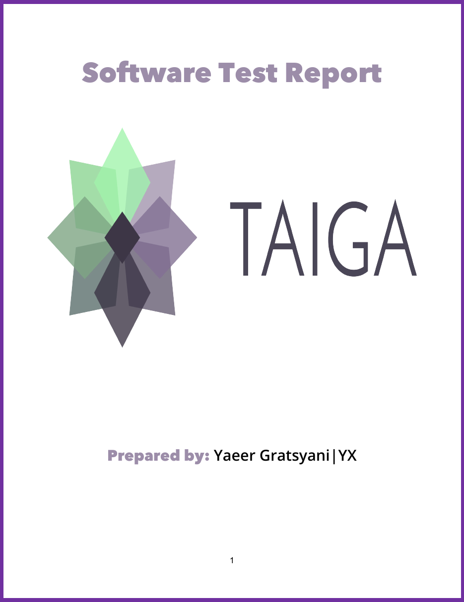
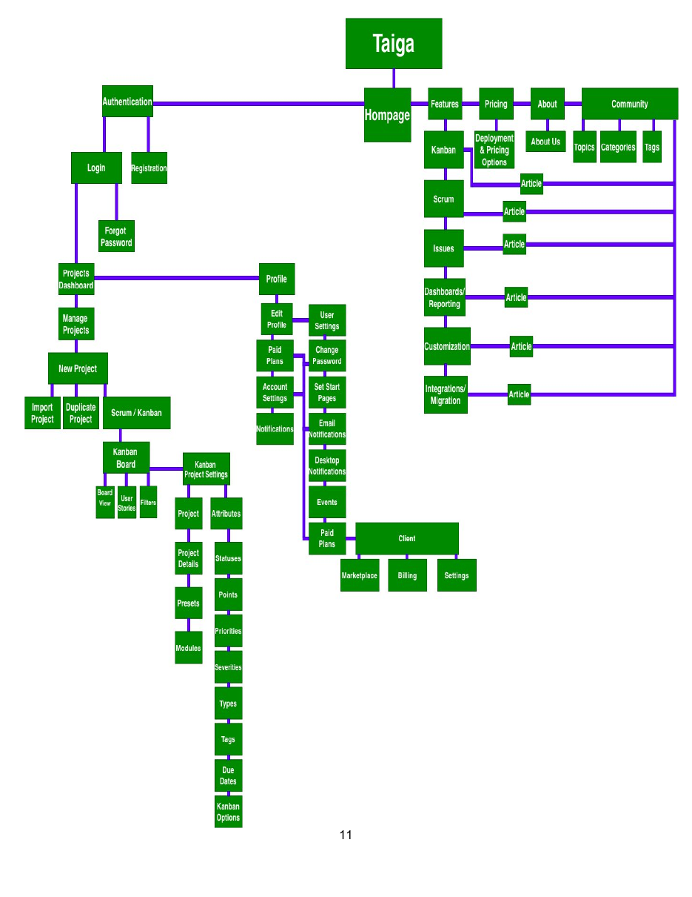
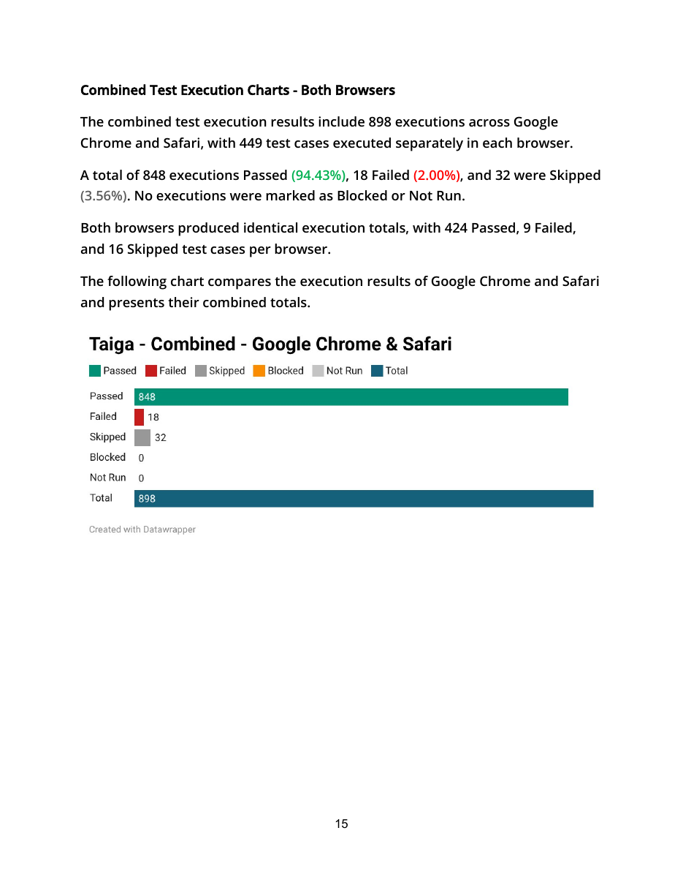
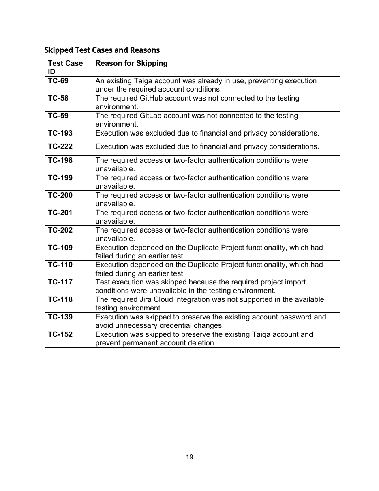
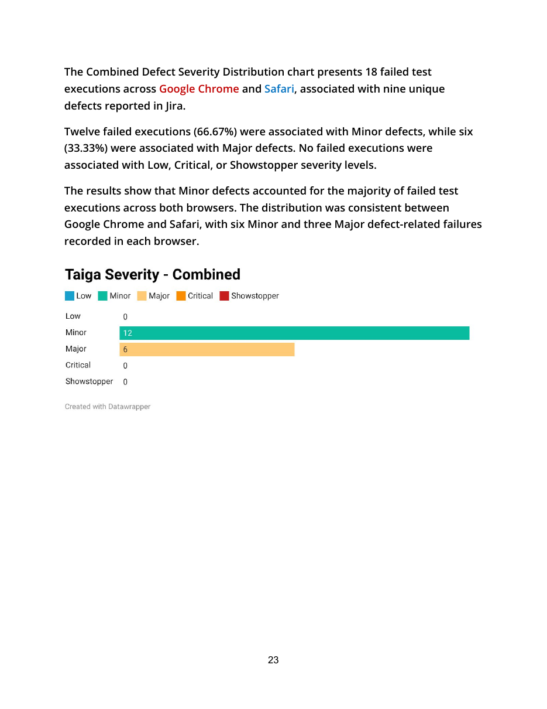
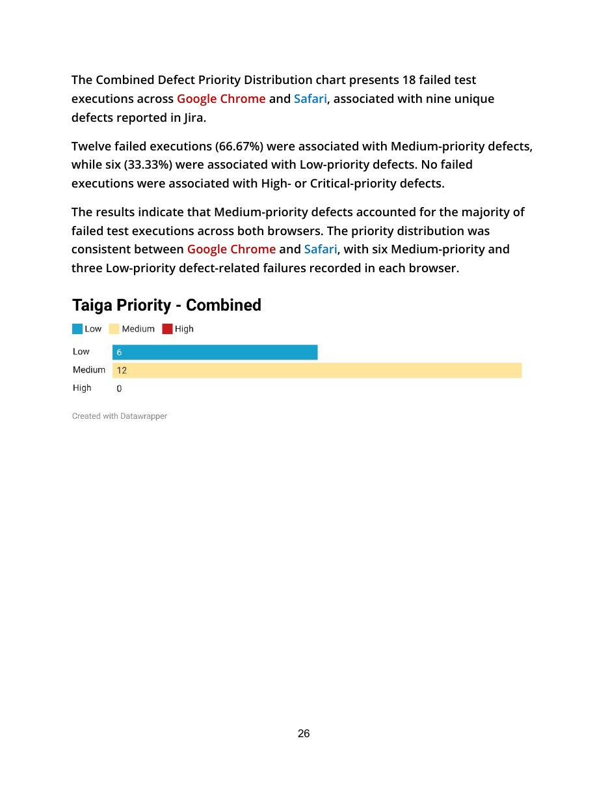
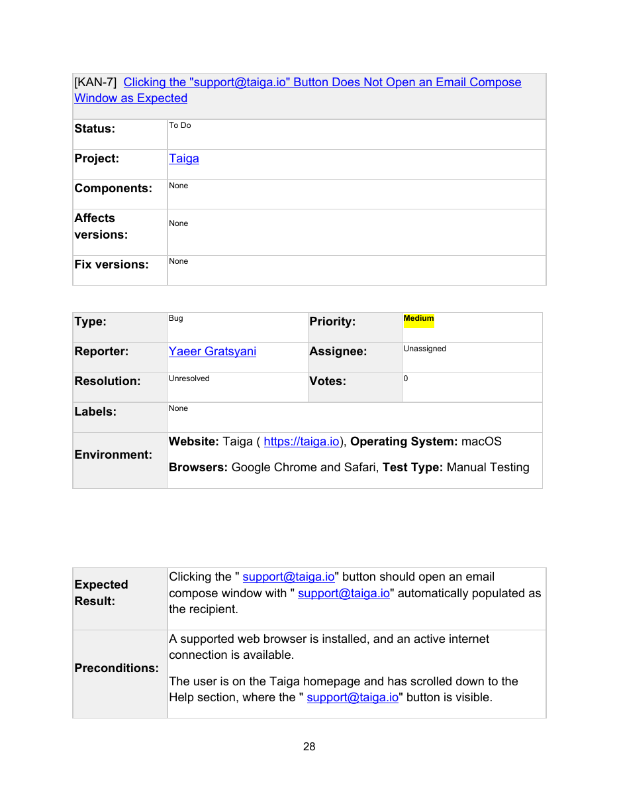

# 📋 Taiga: Software Test Report (STR)

Manual QA project for **[Taiga](https://taiga.io)**, an open-source Agile project management platform for Kanban and Scrum teams.

I wrote and executed 449 test cases in Testiny across Google Chrome and Safari (898 executions), reported 9 unique defects in Jira, and documented everything in a full Software Test Report.

📄 **[Read the full STR (PDF, 47 pages)](Taiga%20STR%20Project.pdf)**

<table>
<tr>
<td align="center"> STR cover</td>
<td align="center"> Testing tree</td>
</tr>
</table>

---

## 📊 Key Numbers

| Test Cases | Executions | Browsers | Pass Rate | Unique Defects |
|:---:|:---:|:---:|:---:|:---:|
| **449** | **898** | **2** (Chrome, Safari) | **94.43%** | **9** (Jira) |

---

## ✅ Test Execution Results (Testiny)

| Status | Safari | Google Chrome | Combined |
|---|:---:|:---:|:---:|
| ✅ Passed | 424 | 424 | 848 (94.43%) |
| ❌ Failed | 9 | 9 | 18 (2.00%) |
| ⏭️ Skipped | 16 | 16 | 32 (3.56%) |
| ⛔ Blocked | 0 | 0 | 0 |
| **Total** | **449** | **449** | **898** |

Both browsers produced identical results.

   Combined execution results: Chrome and Safari

---

## 🎯 Testing Scope

**In scope:** Homepage · Menu · Footer · Agile Management · Community · Login · Registration · Projects · Kanban Settings · Client Portal

**Out of scope:** Scrum workflows · Members & Permissions · Integrations & Plugins · CSV Export · Custom Fields · Performance testing · Firefox and Edge

Most test cases were functional, with positive and negative scenarios.

---

## ⏭️ Skipped Tests

16 test cases were skipped on purpose and documented with a reason for each: unavailable external accounts (GitHub, GitLab, Jira Cloud), two-factor authentication conditions, financial and privacy considerations, protecting the test account from deletion or password changes, and dependency on a feature that had already failed.

   Skipped test cases and reasons

---

## 🐞 Defects (Jira)

| ID | Bug | Type | Severity | Priority |
|---|---|---|:---:|:---:|
| KAN-7 | "support@taiga.io" button on the homepage does not open an email compose window | Usability | Minor | Medium |
| KAN-15 | "support@taiga.io" button on the Client page does not open an email compose window | Usability | Minor | Medium |
| KAN-8 | Help Center opens in Spanish although English (US) is selected | Usability | Major | Medium |
| KAN-9 | "REGISTER" button intermittently fails to open the registration page | Functional | Minor | Medium |
| KAN-10 | Duplicating a public project gets stuck in infinite loading | Functional | Major | Medium |
| KAN-11 | Duplicating a private project gets stuck in infinite loading | Functional | Major | Medium |
| KAN-12 | "Days to Due Date" field accepts letters (User Story) | Functional | Minor | Low |
| KAN-13 | "Days to Due Date" field accepts letters (Task) | Functional | Minor | Low |
| KAN-14 | "Days to Due Date" field accepts letters (Issue) | Functional | Minor | Low |

Every bug report includes preconditions, environment, steps to reproduce, expected vs. actual results, severity, priority and video evidence from both browsers.

<table>
<tr>
<td align="center"> Severity distribution</td>
<td align="center"> Priority distribution</td>
</tr>
</table>

   Example bug report (KAN-7)

---

## 📝 Release Recommendation

**Recommended for release** within the tested scope. Taiga showed good functional stability in both browsers. The three Major defects should be reviewed first, followed by regression testing after fixes.

---

## 🔜 Next Steps

This project is planned to continue with:

1. **SQL testing** with PostgreSQL
2. **API testing** with Postman
3. **Automation** with Python, Playwright and Allure

---

## 🛠️ Tools

---

**Prepared by:** Yaeer Gratsyani | YX &nbsp;·&nbsp; [LinkedIn](https://www.linkedin.com/in/yx-/) &nbsp;·&nbsp; [GitHub](https://github.com/YaeerYX)
